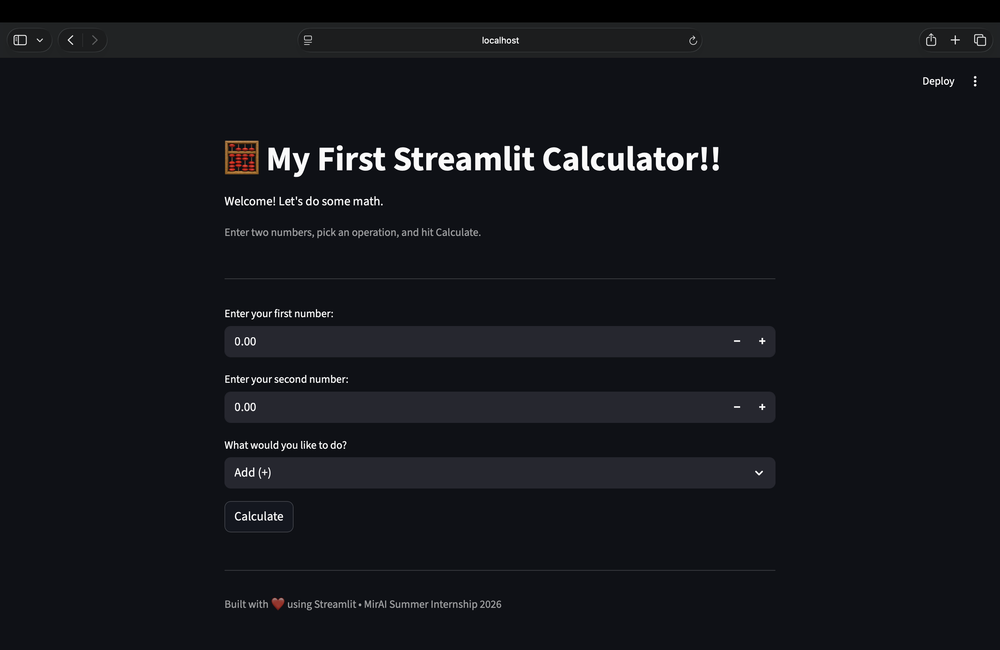
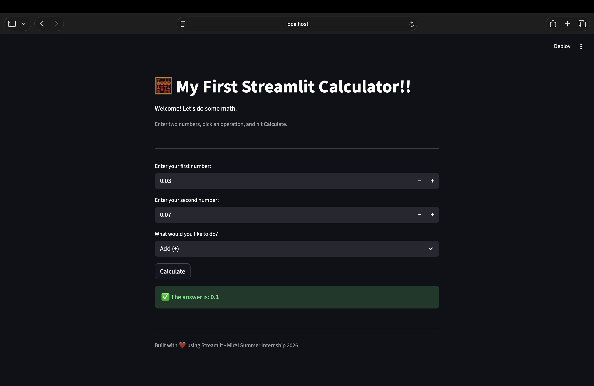

# Assignment 2 - My First Streamlit Calculator

## Objective

Build an interactive Streamlit calculator application that:

- Takes two numbers as input
- Lets the user choose a mathematical operation
- Displays the result instantly
- Handles edge cases like division by zero

---

## Features

- ✅ First Number Input
- ✅ Second Number Input
- ✅ Operation Selection (Add, Subtract, Multiply, Divide)
- ✅ Result Display
- ✅ Division by Zero Error Handling
- ✅ Clean Streamlit Interface

---

## Technologies Used

- Python
- Streamlit

---

## Project Structure

```text
Assignment-2/
│
├── calculator.py
├── requirements.txt
├── README.md
└── screenshots/
```

---

## How to Run

```bash
pip install -r requirements.txt
streamlit run calculator.py
```

---

## 📸 Screenshots

### 🏠 Home Screen

Displays the initial calculator interface where users can enter two numbers and select an operation.



---

### ✅ Calculation Result

Shows the result after a valid calculation is performed.



---

## Concepts Covered

- Streamlit UI
- Number Inputs
- Selectbox / Dropdowns
- Conditional Statements
- Edge Case Handling
- Basic Python Arithmetic
