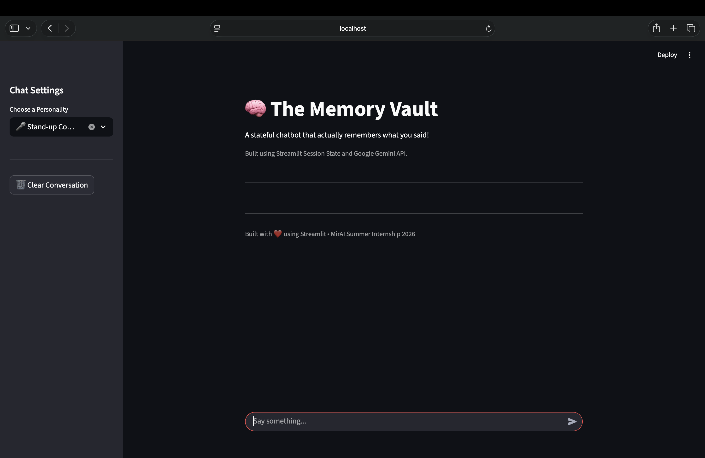
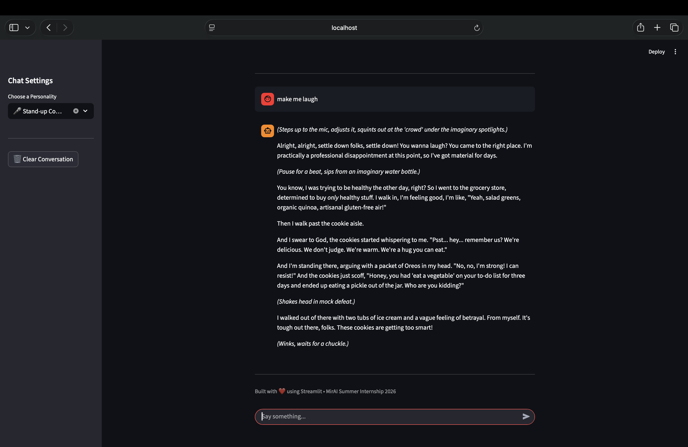

# Assignment 4 - The Memory Vault (Stateful Chatbot)

## Objective

Upgrade the AI Multiverse Chatbot from a **stateless** app (forgets everything on rerun) to a **stateful** app (remembers full conversation history) using Streamlit's `st.session_state`.

---

## Features

- ✅ Task 1: Memory Vault initialized using `st.session_state`
- ✅ Task 2: Chat history rendered on every rerun
- ✅ Task 3: Native `st.chat_input()` replaces old text input + button
- ✅ Task 4: User & AI messages saved to session state after every exchange
- ✅ Multiple AI Personalities (Yoda, Deadpool, Jack Sparrow, Comedian, Sherlock)
- ✅ Clear Conversation Button
- ✅ Secure API Key via `.env`
- ✅ Error Handling for API Failures

---

## Technologies Used

- Python
- Streamlit
- Google Gemini API (`google-genai`)
- python-dotenv

---

## Project Structure

```text
Assignment-4/
│
├── app.py
├── requirements.txt
├── README.md
├── .env
└── screenshots/
```

---

## How to Run

1. Install dependencies

```bash
pip install -r requirements.txt
```

2. Create a `.env` file

```env
GEMINI_API_KEY=YOUR_API_KEY_HERE
```

3. Run the app

```bash
streamlit run app.py
```

---

## 📸 Screenshots

### 🏠 Home Screen

Displays the initial chat interface with personality selector in the sidebar.



---

### 💬 Multi-turn Conversation

Shows the chatbot remembering previous messages across multiple turns.



---

## Key Concepts

- `st.session_state` — persists data across reruns (The Memory Vault)
- `st.chat_input()` — native Streamlit chat input with walrus operator (`:=`)
- `st.chat_message()` — renders user/assistant bubbles
- Stateful vs Stateless apps
- Prompt Engineering with AI Personalities

---

*Built as part of the MirAI School of Technology Virtual Summer Internship 2026.*
