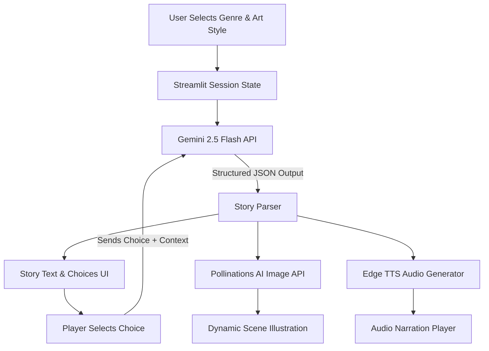

# 📖 StoryVerse — AI-Powered Visual Novel

> **MirAI School of Technology – Virtual Summer Internship 2026 (AI Builder Track)**  
> **Assignment 5**: Multi-Modal AI Storytelling Engine

StoryVerse is an interactive visual novel platform that generates immersive, branching adventures in real-time. Built with **Streamlit**, **Google Gemini 2.5 Flash**, **Pollinations AI**, and **Microsoft Edge TTS**, it brings stories to life using AI-generated narrative, dynamic scene artwork, and spoken audio narration.

---

## 🌟 Key Features

- 🎭 **Dynamic Genres & Visual Art Styles**: Select from 8 story genres (Dark Fantasy, Cyberpunk Thriller, Space Opera, Mythological Adventure, etc.) and 8 distinct artistic styles (Studio Ghibli, Anime, Cinematic Realism, Dark Gothic, etc.).
- 🤖 **Structured JSON Narrative Engine**: Powered by Google Gemini (`gemini-2.5-flash`), enforcing strict JSON schemas to deliver titles, cinematic descriptions, precise image prompts, and 3 distinct branching player choices.
- 🖼️ **Real-Time Visual Generation**: Integrates Pollinations AI to generate scene-specific, high-definition concept art based on character appearance, lighting, mood, and visual style.
- 🔊 **Voice Narration (TTS)**: Converts generated story text into high-quality spoken audio using Microsoft Edge Neural TTS (`en-US-AndrewNeural`).
- 💾 **Stateful Interactive Progression**: Leverages Streamlit `st.session_state` and persistent Gemini chat sessions to remember story context, character development, and choices across turns.
- 🛡️ **Fail-Safe Robust Architecture**: Features graceful fallback handling for API rate limits, network timeouts, image rendering issues, or JSON parsing anomalies.

---

## 🛠️ Tech Stack

- **Framework**: Python 3.9+, Streamlit
- **LLM Engine**: Google Gemini API (`google-genai` SDK)
- **Image Generation**: Pollinations AI REST API
- **Text-to-Speech**: Microsoft Edge TTS (`edge_tts` & `asyncio`)
- **Config & Utilities**: `python-dotenv`, `requests`, `json`

---

## 🏗️ Architecture & How It Works



1. **Initialization**: The user configures story genre and visual style from the sidebar.
2. **Prompt Generation**: Gemini creates the opening scene in 2nd-person narrative ("You..."), a scene-specific image prompt, and 3 meaningful action choices formatted strictly in JSON.
3. **Multi-Modal Rendering**:
   - The scene text is rendered in Streamlit.
   - Pollinations AI fetches an image corresponding to the visual prompt and chosen art style.
   - Edge TTS synthesizes spoken audio narration saved as `story.mp3`.
4. **Interactive Branching**: Player clicks a choice button, sending the choice back into the persistent chat session to continue the story naturally without resetting context.

---

## 🚀 Getting Started

### 1. Prerequisites
Ensure you have **Python 3.9+** installed on your system.

### 2. Installation & Setup

```bash
# Navigate to Assignment 5 directory
cd Assignments/Assignment-5

# Install required packages
pip install -r requirements.txt
```

### 3. Environment Variables
Create a `.env` file in the `Assignment-5` directory:

```env
GEMINI_API_KEY=your_gemini_api_key_here
```

### 4. Run the Application

```bash
streamlit run assignment5.py
```

Open your browser at `http://localhost:8501`.

---

## 📂 Project Structure

```text
Assignment-5/
├── assignment5.py      # Main Streamlit visual novel app
├── README.md           # Project documentation
├── requirements.txt    # Python dependencies
└── demo/
    └── demo-video      # Link to video demonstration on Google Drive
```

---

## 🎥 Video Demo

A video walkthrough demonstrating StoryVerse in action is available:
- 🔗 [Google Drive Demo Video](https://drive.google.com/file/d/1tomwLrM6eWgyqzeHFfppebuF3874FCs4/view?usp=sharing)
- Located locally in `demo/demo-video`.

---

## 🎓 Learning Outcomes & Concepts Covered

- **Structured Prompt Engineering**: Outputting deterministic JSON schema from LLMs.
- **Multi-Modal Integration**: Seamlessly orchestrating Text (Gemini), Image (Pollinations), and Audio (Edge TTS).
- **Session State Management**: Maintaining interactive, multi-turn application state across reruns.
- **Async Execution in Streamlit**: Running asynchronous TTS routines within Streamlit UI lifecycle.
- **Resilient UI Design**: Providing user feedback via toasts and fallbacks when external APIs fail.

---

*Developed for the MirAI School of Technology Virtual Summer Internship 2026.*
