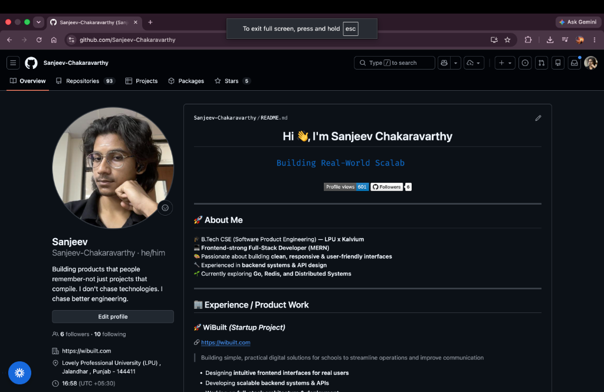
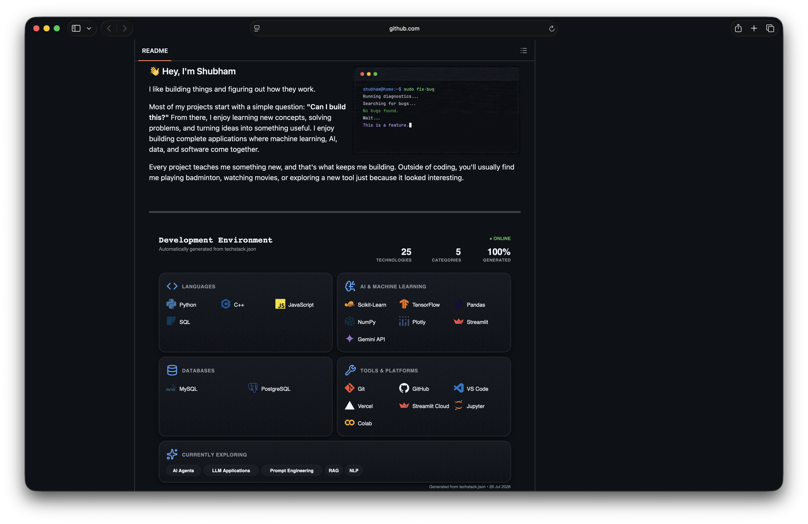
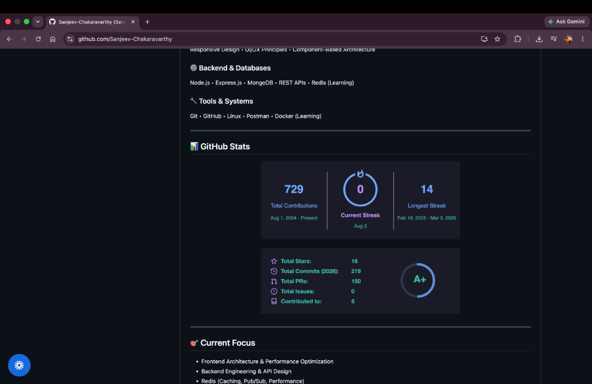

# Hi 👋, I'm Sanjeev Chakaravarthy

  

## 🚀 About Me
- 🎓 **B.Tech CSE (Software Product Engineering)** — LPU x Kalvium
- 💻 **Frontend-strong Full-Stack Developer (MERN)**
- 🎨 Passionate about building clean, responsive & user-friendly interfaces
- 🔧 Experienced in backend systems & API design
- 🌱 Currently exploring Go, Redis, and Distributed Systems

---

## 🏢 Experience & Product Work

### 🚀 **WiBuilt** *(Startup Project)*
- 🔗 [wibuilt.com](https://wibuilt.com)
- Building simple, practical digital solutions for schools to streamline operations and improve communication.
- Designing intuitive frontend interfaces for real users.
- Developing scalable backend systems & APIs.
- Working on full-stack architecture & deployment.
- Focused on performance, usability & real-world impact.

---

## 🚀 Key Projects

### 🏠 **PG Finder**
- 🔗 [Live Demo](https://pg-finder-pink.vercel.app)
- Full-stack platform to help students find PG accommodations based on budget and location.
- Built responsive UI using **React + Tailwind CSS**.
- Designed user-friendly filtering & search experience.
- Integrated REST APIs with **MongoDB** backend.
- Focused on UX, performance, and scalability.

### 🔁 **Skillfinix** *(Ongoing)*
- 🔗 [Live Demo](https://skillfinix.vercel.app)
- Peer-to-peer skill exchange platform with real-time communication.
- Building modern UI with real-time interactions.
- Implementing chat, video calls, and authentication.
- Utilizing **Socket.IO, WebRTC, and JWT**.
- Focused on interactive UX and system performance.

---

## 🛠️ Tech Stack

| Category | Technologies |
|---|---|
| **Languages** | JavaScript • Python • C++ • Java • Go *(Learning)* |
| **Frontend** | React • Redux • Tailwind CSS • HTML • CSS |
| **Backend & DB** | Node.js • Express.js • MongoDB • REST APIs • Redis *(Learning)* |
| **Tools & Systems** | Git • GitHub • Linux • Postman • Docker *(Learning)* |

---

## 📊 GitHub Stats

  

  

---

## 🎯 Current Focus
- Frontend Architecture & Performance Optimization
- Backend Engineering & API Design
- Redis (Caching, Pub/Sub, Performance)
- Go for Systems Programming
- Distributed Systems & Observability
- Open Source Contributions (LFX Ready)

---

## 🏆 Achievements
- 🥈 **Runner-up** — Code-A-Hunt 2.0 (LPU)
- 🎓 **Kalvium Industry Program Scholar**

---

## 📸 Assignment Deliverables & Screenshots
*(This documentation represents Assignment 6 of the MirAI School of Technology Virtual Summer Internship 2026)*

### 1. Hero Section Preview

### 2. Projects & Experience Preview

### 3. GitHub Stats Preview

---

## 🌍 Connect With Me
*Designing smooth user experiences • Building scalable systems • Shipping real products 🚀*
