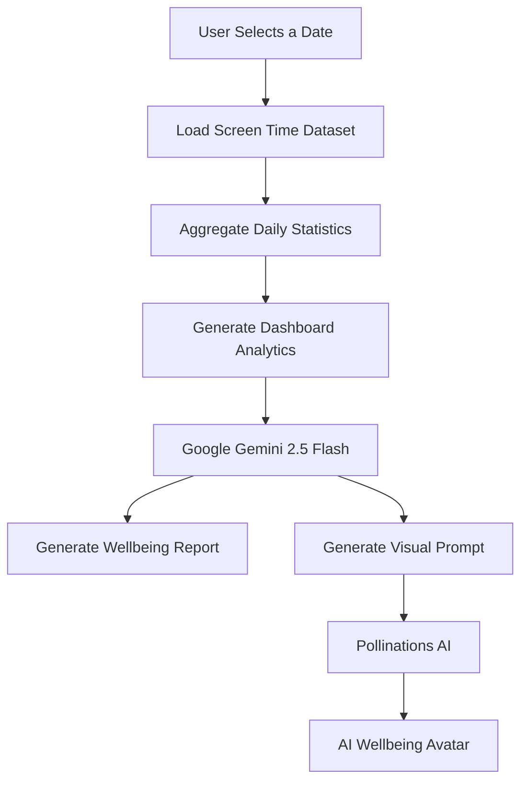
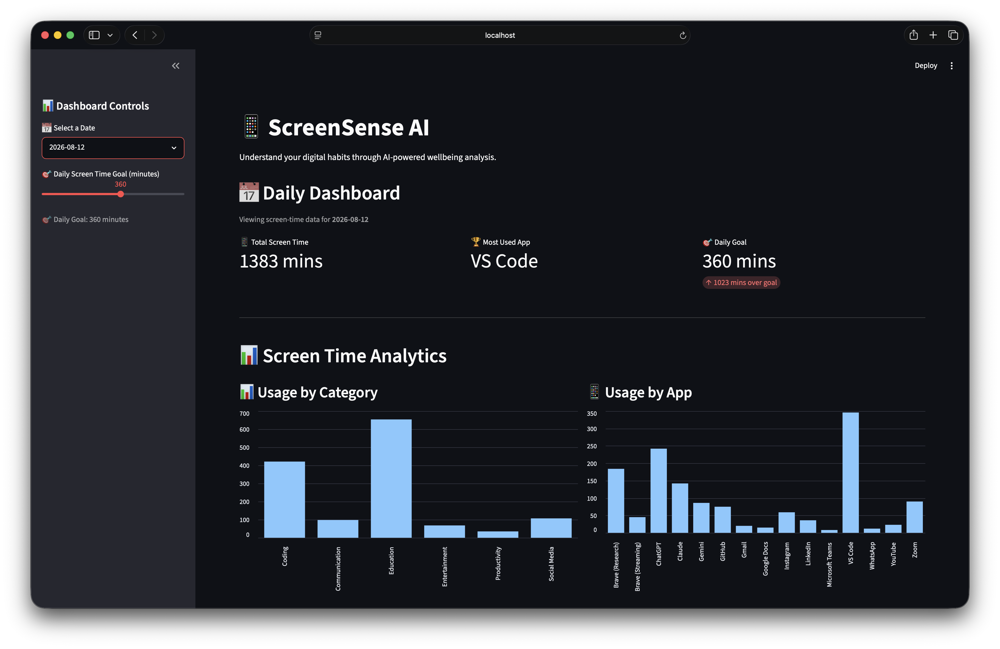
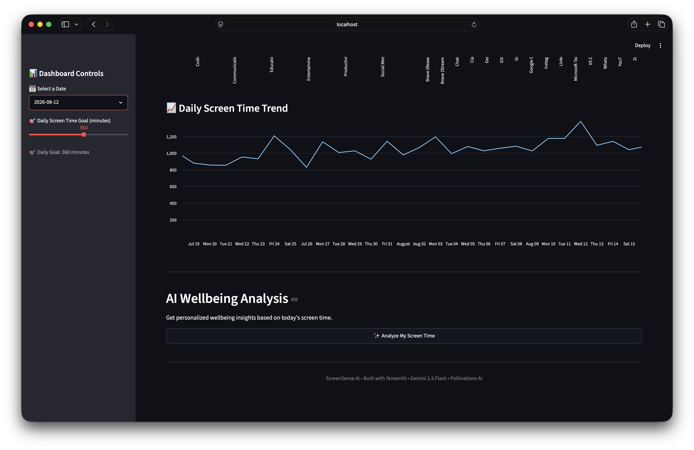
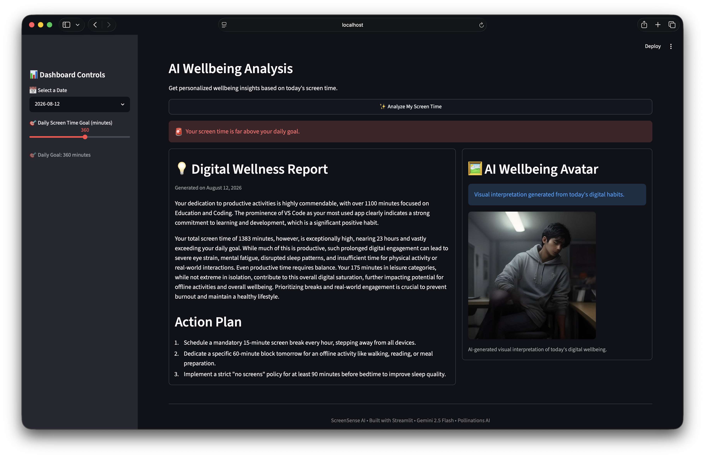
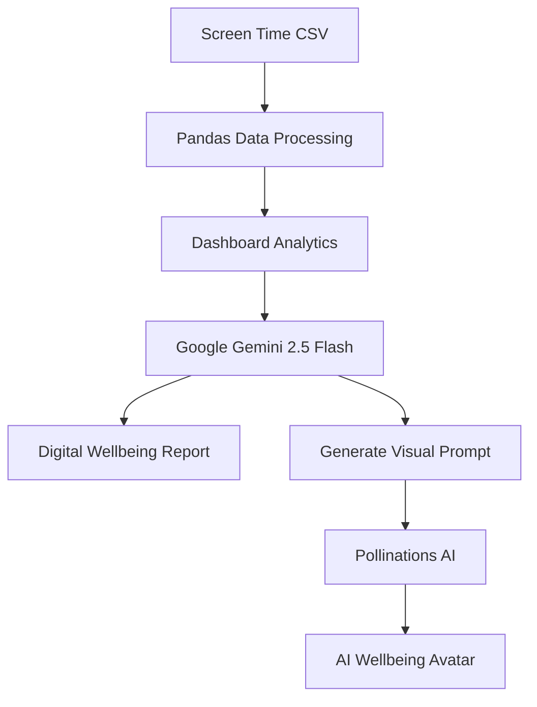

# 📱 ScreenSense AI

> AI-powered digital wellbeing dashboard built with **Streamlit**, **Google Gemini 2.5 Flash**, and **Pollinations AI**.


---

## 📖 Overview

ScreenSense AI transforms raw screen-time data into meaningful digital wellbeing insights.

Instead of simply displaying statistics, the application analyzes daily usage patterns using **Google Gemini 2.5 Flash** to generate personalized lifestyle recommendations. It then creates a symbolic AI-generated wellbeing avatar using **Pollinations AI**, providing a visual interpretation of the user's digital habits.

The dashboard combines interactive analytics, artificial intelligence, and modern UI design to help users better understand how they spend their time across different applications and categories.

---

## ✨ Features

- 📊 Interactive daily screen-time dashboard
- 📅 Analyze any day from the dataset
- 📈 Category-wise usage visualization
- 📱 App-wise usage visualization
- 📉 30-day screen-time trend analysis
- 🎯 Adjustable daily screen-time goal
- 🤖 AI-generated digital wellbeing report
- 💡 Personalized productivity recommendations
- 🖼️ AI-generated wellbeing avatar created from a Gemini-generated visual prompt using Pollinations AI
- 🌙 Clean responsive dark-themed interface

---

## 🌟 Innovation Deliverable

To extend the dashboard beyond traditional analytics, ScreenSense AI implements the **AI Wellbeing Avatar** feature.

The application sends the user's screen-time statistics to **Gemini 2.5 Flash**, which generates a detailed visual prompt describing the user's overall digital wellbeing.

That prompt is then passed to **Pollinations AI**, which creates a symbolic illustration representing the user's habits.

Instead of only reading feedback, users also receive an AI-generated visual interpretation of their digital lifestyle.

---

## 🧠 How It Works



---

## 📸 Screenshots

### 📊 Dashboard Overview



---

### 📈 Screen Time Analytics



---

### 🤖 AI Wellbeing Report & Avatar



---

## 🛠️ Tech Stack

### Frontend

- Streamlit

### Backend

- Python

### Data Processing

- Pandas

### Artificial Intelligence

- Google Gemini 2.5 Flash
- Pollinations AI

### Environment Management

- python-dotenv

---

## 📁 Dataset

The project uses a simulated screen-time dataset (`screentime.csv`).

A companion script, `csv_generator.py`, is included to generate realistic sample data for testing and demonstration.

Each generated record contains:

- Date
- Day
- Application Name
- Usage Category
- Minutes Used

Including the generator makes the project reproducible and allows anyone to create new datasets without modifying the application.

---

## 📂 Project Structure

```text
Assignment-7/
│
├── assignment7.py
├── csv_generator.py
├── screentime.csv
├── requirements.txt
├── README.md
│
└── screenshots/
    ├── dashboard.png
    ├── analytics.png
    └── ai-report.png
```

---

## ⚙️ Installation

### Clone the repository

```bash
git clone https://github.com/Sanjeev-Chakaravarthy/mirai-ai-summer-internship-assignments-2026.git
```

### Move into Assignment 7

```bash
cd mirai-ai-summer-internship-assignments-2026/Assignments/Assignment-7
```

### Install dependencies

```bash
pip install -r requirements.txt
```

### Create a `.env` file

```env
GEMINI_API_KEY=YOUR_GEMINI_API_KEY
```

### Run the application

```bash
streamlit run assignment7.py
```

---

## 🎯 AI Workflow



---

## 🎓 Key Learning Outcomes

Through this project I learned how to:

- Build interactive dashboards with Streamlit
- Process and visualize screen-time datasets using Pandas
- Integrate Gemini 2.5 Flash into Python applications
- Engineer prompts for both text and image generation
- Combine multiple AI services into a single application
- Design responsive dashboards with Streamlit layouts
- Build end-to-end AI-powered data applications

---

## 🚀 Future Improvements

- Weekly and monthly wellbeing reports
- User authentication
- Personalized productivity scoring
- PDF wellbeing report export
- Email summaries
- Historical AI trend analysis
- Voice journal integration
- Habit tracking
- Mobile responsive optimization
- Multi-user support

---

## 📄 License

This project was developed as part of the **MirAI School of Technology AI Summer Internship 2026**.

It is intended for educational and portfolio purposes.

---

### 👨‍💻 Author

**Sanjeev Chakaravarthy**

Computer Science Student | Frontend-strong Full-Stack Developer (MERN)

GitHub: https://github.com/Sanjeev-Chakaravarthy

Portfolio: https://portfolio-kohl-omega-6oxgi0x1j4.vercel.app

LinkedIn: https://linkedin.com/in/sanjeev-m-s-908188325
